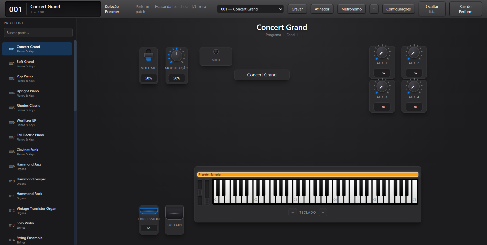
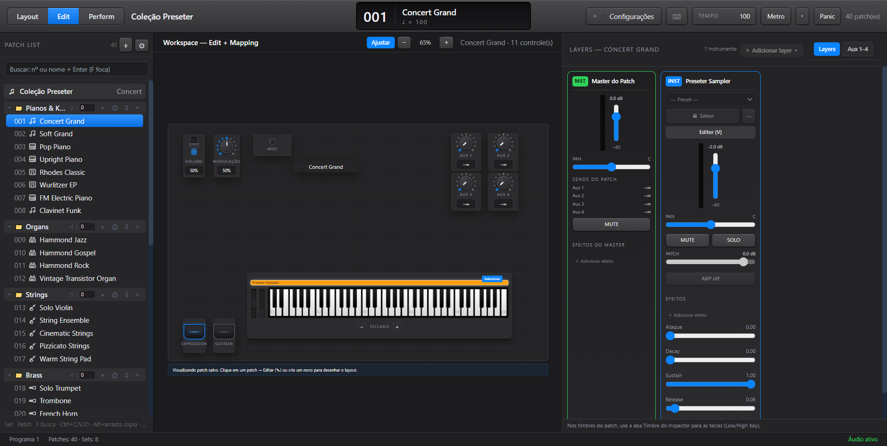
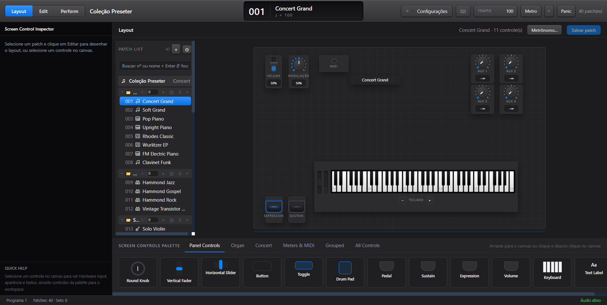
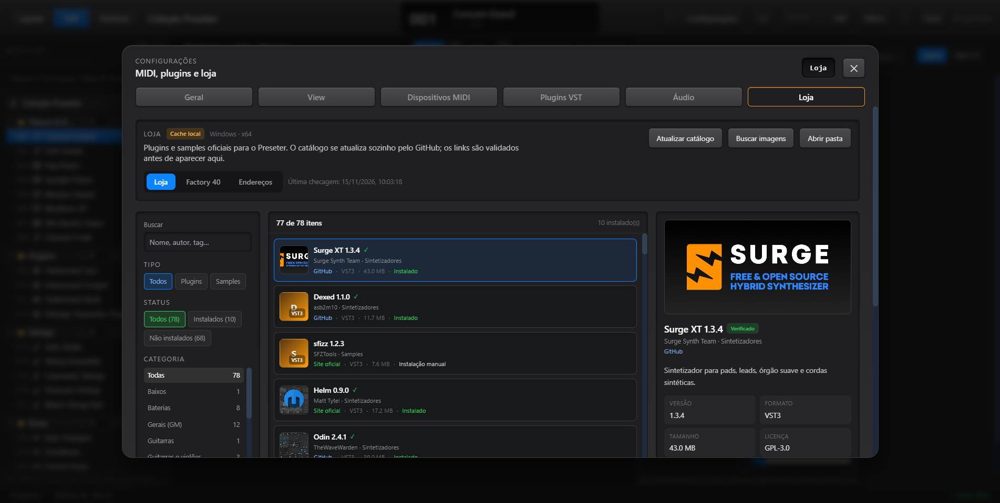

# Preseter

**Software livre de performance ao vivo para músicos.** Organize seus sons em sets e patches, toque no palco com teclado, pedais e controladores MIDI, e carregue VST3/LV2 sem sair do app — inspirado no MainStage e no Gig Performer.

## Telas

### Perform — a tela do show



Patch list à esquerda, controles do patch no centro, teclado na tela e botões de pânico/troca. Tudo mapeável para MIDI.

### Editar — workspace e mapping



Monte o layout do patch arrastando controles, edite os channel strips (instrumento, inserts, sends e Master do Patch) e mapeie cada controle para um CC, nota ou pedal.

### Layout — editor visual



Inspetor de controles, paleta de knobs/faders/pads e o canvas do show. O mesmo layout vale para o concert inteiro, patch a patch.

### Loja — plugins e samples



Catálogo de plugins e samples atualizado pelo GitHub, com instalação em um clique e filtros por tipo, categoria e status.

## Recursos

- **Concert → Sets → Patches**: organização completa, com troca por Program Change, setas, atalhos de teclado e busca.
- **Anfitrião de plugins**: VST3 no Windows/Linux e LV2 (Guitarix embutido), com editor nativo, presets, estado por patch e MIDI learn.
- **Instrumentos nativos**: órgão, piano elétrico (Tines/Wurly), piano acústico, DX10, JX10, Synth2, Zyn (ZynAddSubFX), bateria e sampler (SF2/SFZ).
- **34 efeitos embutidos** (29 calfnXT + 5 Guitarix) com painéis próprios, presets em valores reais (dB, ms, Hz), versões para insert e para Aux, reset por duplo clique, roda do mouse e entrada numérica.
- **Console ao vivo**: Master do Patch, 4 Aux (reverb/delay), sends por layer, 4 saídas, pan e mute.
- **Tudo mapeável**: controles de tela, pedais, expressão, sustain, knobs e pads via MIDI learn; mappings por concert/set/patch.
- **Palco**: modo Perform em tela cheia, metrônomo, afinador, gravação (WAV/MP3/FLAC) e modo de performance.
- **Coleções prontas**: 40 patches de fábrica (Factory 40) e templates de concert (guitarra, show de 10 músicas, full set).
- **Motor de áudio próprio** (JUCE/C++): baixa latência, ASIO no Windows, JACK no Linux, host clock (BPM) para plugins sincronizados.

## Download

Pegue o instalador mais recente em **[Releases](https://github.com/raphaleandrodasilva-pixel/Preseter/releases)**:

- **Windows**: instalador NSIS (x64)
- **Linux**: AppImage e `.deb`

> O Preseter é livre (AGPL-3.0-or-later). O instalador já inclui o motor e os efeitos embutidos.

## Desenvolvimento

Pré-requisitos: **Node.js 22+**, **Git** e, para compilar o motor, **CMake ≥ 3.25** + Visual Studio 2022 (Windows) ou build-essential + libasound2-dev (Linux).

```bash
npm ci
npm run build:engine:linux   # Linux (no Windows, compile engine/ com CMake/VS)
npm run dev                  # Vite + Electron em modo desenvolvimento
npm test                     # testes (Vitest)
npm run typecheck
npm run package              # instalador (electron-builder)
```

### Estrutura

```
engine/              motor de áudio em C++/JUCE (PreseterEngine)
src/main/            processo principal do Electron (plugins, áudio, concertos)
src/renderer/        interface React (Perform, Edit, Layout, Loja…)
src/shared/          tipos e contratos compartilhados
  effects/           catálogo de efeitos + presets
    presets-src/     fonte dos presets em valores reais (dB, ms, Hz)
vendor/              calfnXT (VST3) e Guitarix (LV2) embarcados
docs/                imagens e documentação
scripts/             geradores e utilitários
```

### Presets dos efeitos

Os presets **não são editados à mão** no catálogo: a fonte fica em
`src/shared/effects/presets-src/<efeito>.json` com valores reais e o normalizado é
gerado por:

```bash
node scripts/generate-effect-presets.mjs          # grava catalog.json / guitarix.json
node scripts/generate-effect-presets.mjs --check  # falha se estiver desatualizado
```

O teste de nível dos presets (RMS, pico e cauda) é opcional e usa o motor:

```bash
node scripts/check-effect-presets.mjs --effect preseter.reverb --preset hall
```

## Testes

```bash
npm test          # Vitest (interface, main, shared)
npm run typecheck # TypeScript (main + renderer)
```

## Licença

O Preseter é distribuído sob **AGPL-3.0-or-later** — veja [LICENSE](LICENSE).

Componentes de terceiros mantêm suas licenças:

- **calfNXT / Calf Studio Gear** — GPL-3.0-or-later, fork [boomshop/calfnxt](https://github.com/boomshop/calfnxt) (bundle: `vendor/calfnxt`).
- **Guitarix** — GPL-3.0-or-later, LV2 portado (bundle: `vendor/guitarix`).
- **JUCE** — AGPL-3.0 / comercial.
- **setBfree**, **mda-ePiano**, **OpenWurli**, **ZynAddSubFX** — licenças em `engine/third_party/*`.

## Créditos

Feito pela comunidade do Preseter. Contribuições, relatos de bugs e ideias são bem-vindos nas
[issues](https://github.com/raphaleandrodasilva-pixel/Preseter/issues).
