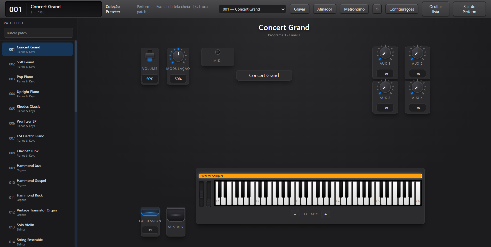
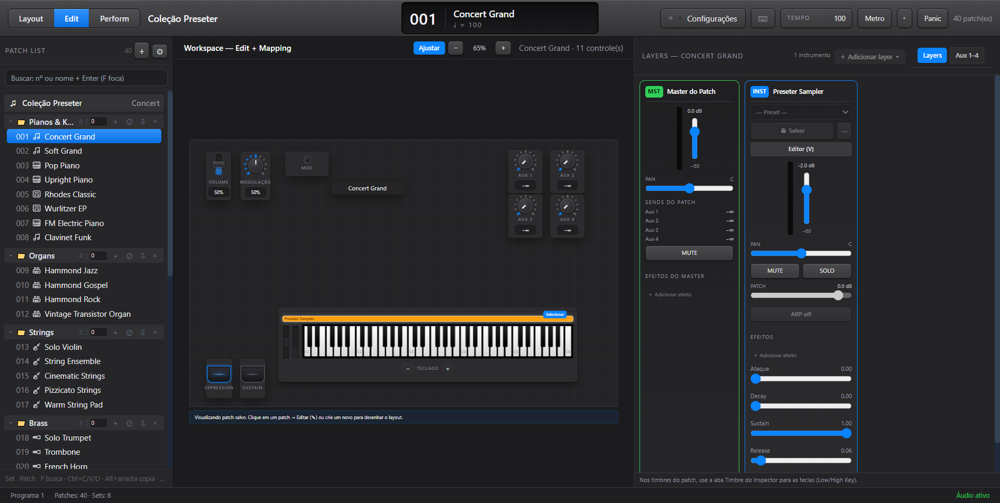
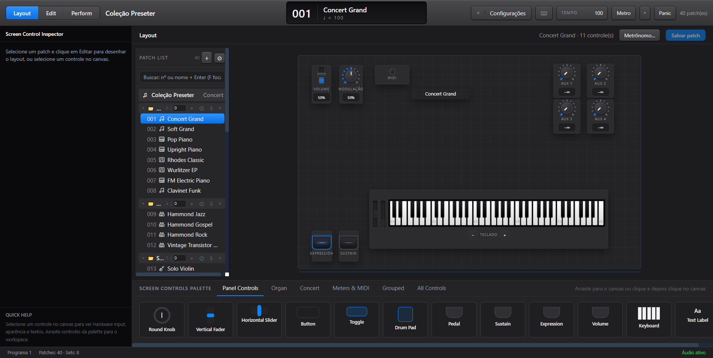
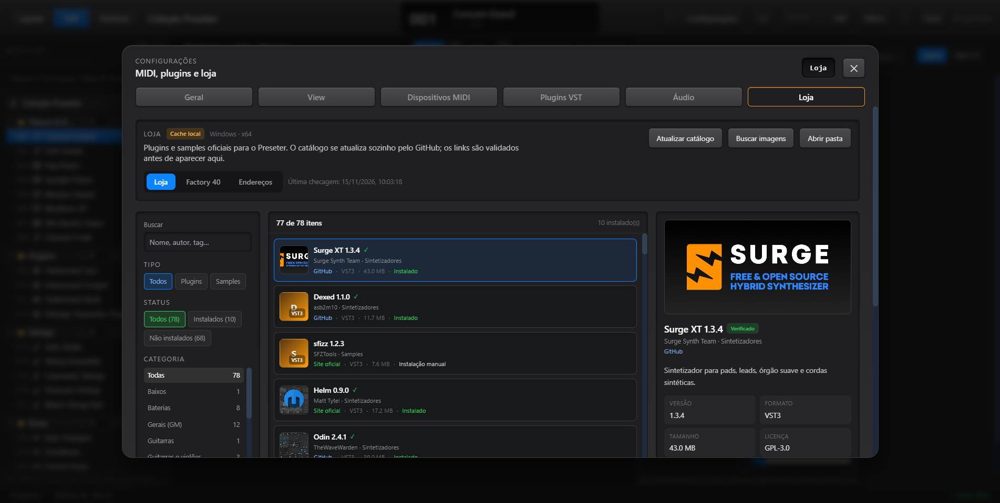

# Preseter

Host de performance ao vivo para **VST3 e LV2** — Windows e Linux, no estilo MainStage e Gig Performer.



[](../LICENSE)
[](https://github.com/raphaleandrodasilva-pixel/Preseter/actions/workflows/build.yml)


## O que é

O Preseter organiza um show inteiro em **concerts → sets → patches**. Cada patch tem seu
layout de controles (teclas, knobs, pads, pedais), seus instrumentos e efeitos, e a troca de
patch acontece **sem cortar o som**: o patch seguinte é carregado enquanto o anterior ainda
soa, e só então as conexões do grafo são trocadas.

O áudio roda em um **processo separado**, escrito em C++ com JUCE. O app Electron conversa
com ele por JSON (uma mensagem por linha em stdin/stdout). Se um plugin travar, quem cai é o
motor — a interface continua de pé e pode reiniciá-lo.

> Status: projeto em desenvolvimento ativo. O roadmap com o que já está pronto e o que falta
> fica em [`ROADMAP.md`](ROADMAP.md).

## Telas

| Edit — workspace e channel strips | Layout — desenho do palco |
| --- | --- |
|  |  |

**Loja integrada** (Configurações → Loja): baixe plugins, samples e bibliotecas sem sair do app.



## Recursos

- **Concert, sets e patches**: arquivo de concert (`.pst`) com undo/redo, copiar/colar/duplicar
  patches, importar/exportar e templates (Vazio, Teclado, Worship, Full Set com 40 patches e MIDI externo).
- **Channel strips completas**: volume, pan, mute, solo, medidor em dBFS, **4 inserts** de efeito
  por strip, **4 sends** post-fader, 4 barramentos **Aux**, 4 **Output**, bus do patch e **Master**.
- **Host de plugins**: VST3 e LV2 no Windows e no Linux (VST2 opcional, se o engine for compilado
  com o SDK). O estado completo do plugin é salvo e restaurado junto com o patch.
- **MIDI**: learn de hardware (`Ctrl+L`), mappings de controle de tela → parâmetro, ações
  (panic, mute, tap tempo, próximo patch…), MIDI Thru configurável e Program Change com banco.
- **Perform**: navegação por sets e patches, tela cheia real (`Ctrl+4`), busca digitando o número
  ou o nome do patch, medidores e controles em tamanho de palco.
- **Música**: metrônomo com acento, tap tempo, transpose por patch/set/concert, afinador e
  relógio do host (tempo/compasso enviados aos plugins).
- **Gravação**: grava a saída do concert em WAV (`Ctrl+R`) e traz um player de áudio interno.
- **Entrada de áudio** para guitarra/microfone, mono ou estéreo, com proteção de feedback.
- **Coleção Factory 40**: baixa e instala plugins e bibliotecas gratuitas (Sforzando, Surge XT,
  Dexed, MuseScore_General etc.) sem precisar de administrador, e gera um concert de 40 timbres.
- **Motor à prova de travamento**: ASIO e WASAPI no Windows; ALSA e JACK no Linux.

## Download e instalação

Os instaladores ficam na página de **[Releases](https://github.com/raphaleandrodasilva-pixel/Preseter/releases)**:

| Plataforma | Arquivo |
| --- | --- |
| Windows 10/11 (x64) | `Preseter Setup <versão>.exe` (NSIS, permite escolher a pasta) |
| Linux (x64) | `.AppImage` (portátil) ou `.deb` |

Cada push na `main` gera novos instaladores em **[Actions](https://github.com/raphaleandrodasilva-pixel/Preseter/actions)**
(artefatos do run). Um **[Release](https://github.com/raphaleandrodasilva-pixel/Preseter/releases/latest)**
é publicado automaticamente quando a `version` do `package.json` ainda não tem tag — ou quando
você envia uma tag `v*`.

### Requisitos

- **Windows 10/11** x64. Para latência baixa, placa de áudio com driver ASIO.
- **Linux** x64 com PipeWire, PulseAudio ou JACK (`libjack-jackd2-0` recomendado).
- Plugins VST3/LV2 instalados nas pastas padrão do sistema (o Preseter também varre pastas extras).

## Primeiros passos

1. Abra o Preseter e escolha um template em **Novo Concert** — ou abra um `.pst` existente com
   **Abrir arquivo…**.
2. Em **Configurações → Áudio**, escolha driver, dispositivo, taxa de amostragem e buffer.
3. Ajuste os patches na lista da esquerda; o layout do palco é compartilhado pelo concert e pode
   ser editado no modo **Layout**.
4. Pressione **Perform** (ou `Ctrl+4`) para tocar em tela cheia.
5. Em **Configurações → Loja**, baixe a coleção de plugins gratuitos e abra o concert **Factory 40**.

## Atalhos principais

| Atalho | Ação |
| --- | --- |
| `Ctrl+1` | Modo Layout |
| `Ctrl+2` | Modo Edit |
| `Ctrl+3` / `Ctrl+4` | Perform em janela / em tela cheia |
| `Ctrl+N` / `Ctrl+O` / `Ctrl+S` | Novo concert / Abrir / Salvar |
| `Ctrl+Z` / `Ctrl+Shift+Z` | Desfazer / Refazer |
| `Ctrl+L` | Learn de hardware → controle de tela |
| `Ctrl+,` | Configurações |
| `Ctrl+P` / `Ctrl+M` | Panic / mute do master |
| `Ctrl+T` / `Ctrl+Shift+T` | Tap tempo / Afinador (Windows) |
| `Ctrl+R` | Gravar a saída do concert |
| `Ctrl+F` | Buscar patch |
| `V` | Abrir/fechar a janela do plugin |

A lista completa, com os detalhes de cada modo, está no [`ROADMAP.md`](ROADMAP.md).

## Compilar do código

Pré-requisitos gerais: **Node.js 20+** e **CMake 3.22+**. O motor baixa o JUCE 8.0.8 sozinho na
primeira configuração (FetchContent), então o primeiro build é mais demorado.

### Windows

```powershell
npm ci
npm run build

cmake -S engine -B engine/build -G "Visual Studio 17 2022"
cmake --build engine/build --config Release --target PreseterEngine

npm run package   # instalador NSIS em release/
```

O executável do motor fica em `engine/build/PreseterEngine_artefacts/Release/PreseterEngine.exe`
e é copiado para `resources/engine/` pelo `electron-builder`.

Com **ASIO** (recomendado para tocar ao vivo), aponte para o SDK da Steinberg que você baixou:

```powershell
cmake -S engine -B engine/build -G "Visual Studio 17 2022" `
  -DPRESETER_ENABLE_ASIO=ON `
  -DPRESETER_ASIO_SDK_DIR="C:\SDKs\asio-sdk"
cmake --build engine/build --config Release --target PreseterEngine
```

O SDK do ASIO não é distribuído com o Preseter (licença própria da Steinberg). Sem ele, o engine
compila normalmente com WASAPI.

### Linux (Ubuntu/Debian)

```bash
sudo apt install build-essential cmake ninja-build pkg-config \
  libasound2-dev libjack-jackd2-dev libfreetype6-dev libx11-dev libxext-dev \
  libxinerama-dev libxrandr-dev libxcursor-dev libgl1-mesa-dev

npm ci
npm run build:engine:linux   # Ninja + JACK habilitado
npm run build
npx electron-builder --linux AppImage deb
```

### VST2 (opcional)

O VST2 não vem habilitado. Para compilar com suporte, use um SDK local:

```powershell
git clone https://github.com/R-Tur/VST_SDK_2.4.git engine/vst2-sdk
cmake -S engine -B engine/build -G "Visual Studio 17 2022" `
  -DPRESETER_VST2_SDK_DIR="$PWD/engine/vst2-sdk"
```

### Desenvolvimento

```bash
npm run dev    # compila o main, sobe o Vite e abre o Electron
```

O motor precisa estar compilado antes de carregar plugins. Detalhes do protocolo e do build do
motor estão em [`../engine/README.md`](../engine/README.md).

## Arquitetura

```
Electron (interface React)
        ⇅  IPC
processo main (Node): janelas, menus, persistência, MIDI
        ⇅  JSON por linha (stdin/stdout)
preseter-engine (C++/JUCE)
        ├─ VST3 / LV2 (+ VST2 opcional)
        ├─ ASIO / WASAPI / ALSA / JACK
        └─ MIDI de entrada e saída
```

O motor é um processo sem janela. Cada comando tem um `id` e recebe a resposta com o mesmo `id`;
eventos (`ready`, `scan-progress`) chegam sem `id`, e logs vão para stderr. A lista de comandos
está em [`../engine/README.md`](../engine/README.md) e os tipos em
[`../src/shared/engine-protocol.ts`](../src/shared/engine-protocol.ts).

## Coleção Factory 40

Em **Configurações → Loja**, o Preseter mostra os plugins e bibliotecas da coleção, instala os
VST3 na pasta do usuário (sem administrador) e monta o concert **Factory 40** com 40 timbres
divididos em 8 famílias (pianos, órgãos, cordas, metais, baixos, bateria, sintetizadores e
percussão). O catálogo fica em
[`catalogo_instrumentos_virtuais_preseter.md`](catalogo_instrumentos_virtuais_preseter.md) e a
descrição dos timbres em
[`Preseter_Biblioteca_40_Patches.md`](Preseter_Biblioteca_40_Patches.md).

## Testes

```bash
npm test             # Vitest: 552 testes entre main, renderer e shared
npm run typecheck    # TypeScript do processo main e do renderer
npm run test:coverage
```

Para validar o motor de áudio sem abrir a interface:

```bash
node scripts/engine-smoke.js                          # ping, dispositivos e scan
node scripts/engine-smoke.js --plugin=Surge --audio   # carrega um plugin e toca uma nota
```

O workflow [`.github/workflows/build.yml`](../.github/workflows/build.yml) roda typecheck e
testes e gera os instaladores de **Windows** (NSIS) e **Linux** (AppImage e deb) a cada push na
`main`. Quando a versão do `package.json` ainda não tem tag, o mesmo workflow publica um GitHub
Release com os instaladores anexados.

## Estrutura do repositório

| Pasta | Conteúdo |
| --- | --- |
| `src/main/` | Processo principal do Electron: janelas, menus, IPC, persistência, MIDI, VST |
| `src/renderer/` | Interface em React + TypeScript (Tailwind) |
| `src/shared/` | Tipos, protocolo do motor e lógica compartilhada (com testes) |
| `engine/` | Motor de áudio nativo em C++/JUCE |
| `scripts/` | Dev, smoke test do engine e geração da coleção |
| `store/` | Catálogo da loja de plugins |
| `docs/` | Roadmap, catálogos e documentação |

## Licença e créditos

O Preseter é distribuído sob **AGPL-3.0-or-later** — veja [`../LICENSE`](../LICENSE).

- **JUCE 8** (motor): AGPLv3 ou licença comercial da Raw Material Software. Confira os termos em
  <https://juce.com/legal>.
- **ASIO SDK** (Steinberg): licença própria/GPLv3, obtido e mantido localmente; não é redistribuído
  no instalador.
- **Plugins de terceiros** (Surge XT, Dexed, Sforzando, MuseScore_General etc.) são projetos
  separados, carregados em tempo de execução; cada um mantém a sua licença.

---

## English summary

**Preseter** is a live performance host for **VST3 and LV2** plugins on **Windows and Linux**,
built in the spirit of MainStage and Gig Performer. It organizes a show into **concerts → sets →
patches**, with per-patch control layouts (keys, knobs, pads, pedals), gapless patch switching,
channel strips with inserts and four aux/output buses, MIDI learn and mappings, metronome, tap
tempo, tuner, transposition, WAV recording and an audio input strip.

Audio runs in a **separate C++/JUCE engine** that talks to the Electron app over line-delimited
JSON, so a crashing plugin doesn't take the UI down. Supported backends: ASIO/WASAPI on Windows and
ALSA/JACK on Linux, with optional VST2 support.

Build with `npm ci && npm run build`, compile the engine with CMake, then run `npm run package`.
Tests: `npm test` (Vitest). Licensed under **AGPL-3.0-or-later**. See
[`ROADMAP.md`](ROADMAP.md) for the feature roadmap and [`../engine/README.md`](../engine/README.md)
for the engine protocol.
